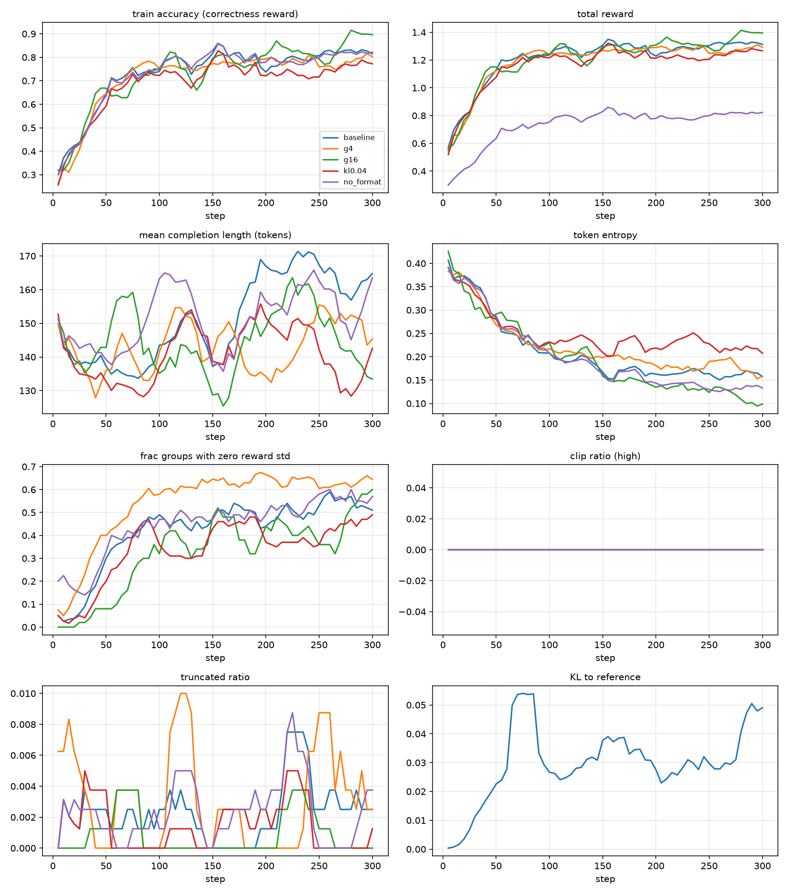
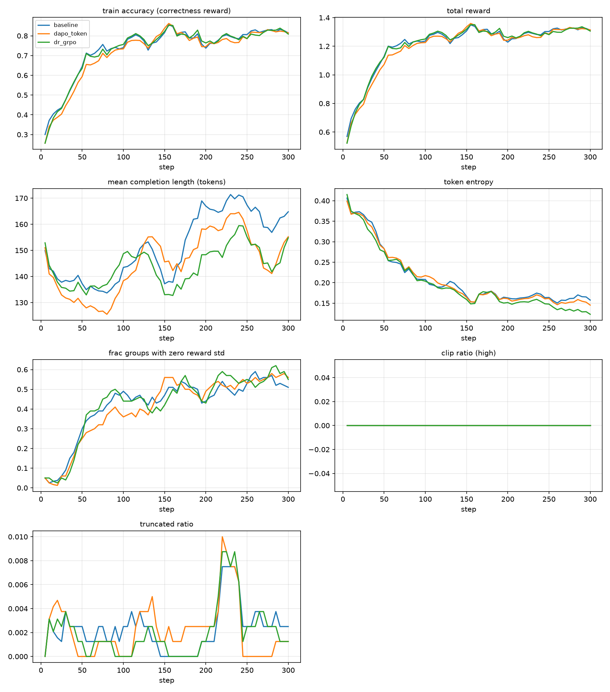
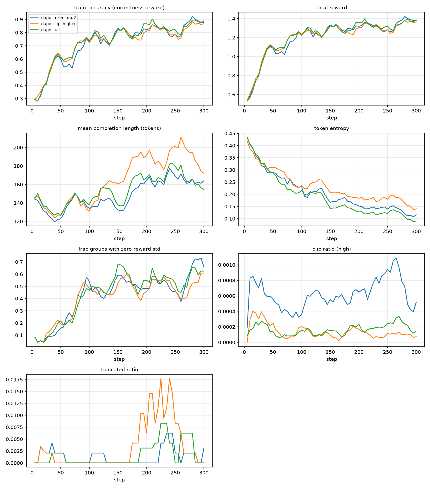

# GRPO-Math：用 GRPO 提升小模型数学推理，并对比 DAPO / Dr. GRPO

> Rule-based GRPO on GSM8K with Qwen2.5-1.5B-Instruct (45.4% → 74.8%), with controlled ablations, DAPO / Dr. GRPO comparisons, paired significance tests and an error-level case study.

在 GSM8K 上用 **GRPO + LoRA** 训练 Qwen2.5-1.5B-Instruct，只用规则化的可验证奖励（正确性 + 格式），不训练奖励模型。在此基础上做单变量消融，逐项加入 DAPO 与 Dr. GRPO 的改进，用逐题配对的 McNemar 检验判断差异是否显著，并逐题分析 RL 到底改变了什么。

## 亮点

- **准确率 45.4% → 74.8%**（GSM8K test，1319 题，贪心解码）。用严格/宽松两种判分拆分：约 **18 个点是推理能力的真实提升**，其余来自格式修复。
- **Case study：RL 主要教会模型“把推理做完”。** 新做对的题里约一半，训练前的错误答案恰好是正确解法的中间结果。
- **Clip-Higher 使训练各阶段的熵提高约 25%**，减缓熵坍缩，与 DAPO 论文的机制一致。
- **两个评测/实验设计问题的排查：**
  - HF `generate()` 默认继承 `repetition_penalty=1.1`，并把 prompt 里示范的格式标签也一起惩罚，使格式率被低估约 50 个点。
  - μ=1（完全 on-policy）时重要性比率恒为 1，PPO 裁剪从不触发，Clip-Higher 会变成空操作。因此 Clip-Higher 相关实验改在 μ=2 下比较。

## 主要结果

所有结果统一使用：user 风格 prompt、贪心解码、`repetition_penalty=1.0`、最长 512 token、vLLM 评测。

| 实验 | 改动 | 严格准确率 | 宽松准确率 | 格式正确率 | 平均长度 |
|---|---|---|---|---|---|
| base | 训练前 | 45.4% | 56.8% | 74.7% | 142 |
| **baseline** | GRPO，G=8，β=0 | **74.8%** | 74.8% | 99.1% | 162 |
| g4 / g16 | group size 4 / 16 | 74.5% / 73.2% | 74.6% / 73.2% | 99.2% / 99.6% | 152 / 145 |
| kl0.04 | 加入 KL 约束 β=0.04 | 73.2% | 73.2% | 99.3% | 148 |
| no_format | 去掉格式奖励 | 75.1% | 75.2% | 99.4% | 170 |
| dapo_token | token 级损失（μ=1） | 73.1% | 73.1% | 99.6% | 150 |
| dr_grpo | 常数归一化 + 不除 std | 76.2% | 76.3% | 99.3% | 163 |
| dapo_token_mu2 | token 级损失（μ=2，参照组） | 74.4% | 74.5% | 98.9% | 180 |
| dapo_clip_higher | + ε_high=0.28 | 75.5% | 75.5% | 98.9% | 182 |
| dapo_full | + 超长惩罚 + 截断 mask | 74.8% | 75.0% | 99.2% | 165 |

严格准确率从 `<answer>` 标签里取答案；宽松准确率取全文最后一个数字，排除格式因素（会漏判约 3%，是下界）。完整数据见 [`results/results.csv`](results/results.csv)，逐题输出见 `results/*.jsonl`。

| 消融（μ=1） | DAPO / Dr. GRPO（μ=1） | Clip-Higher 链条（μ=2） |
|---|---|---|
|  |  |  |

## 核心发现

1. **提升从哪来：** 严格准确率 +29.4 个点，宽松准确率 +18.0 个点，约 11 个点来自格式修复。只看训练前就按格式作答的 985 题，准确率也从 56.2% 涨到 76.6%。
2. **熵坍缩与有效 batch 缩小同时出现：** token 熵 0.36 → 0.16；组内奖励全相同（多为 8 条全对）的比例 8% → 53%，后期一半的组不产生梯度。这正是 DAPO Clip-Higher 和动态采样针对的问题。
3. **消融都不显著：** G=4/16、β=0.04、去掉格式奖励与 baseline 逐题做 McNemar 检验，p 均 > 0.15。差别体现在训练过程：KL 让熵保持最高但学得更慢；G=16 熵坍缩最严重；去掉格式奖励后格式率仍有 99.4%，因为正确性奖励只从 `<answer>` 取答案，已经隐含要求格式。
4. **DAPO / Dr. GRPO 对最终准确率无显著影响：** dr_grpo 76.2%（p=0.17）为所有实验最高；dapo_clip_higher 相对其参照组 +1.1 个点（p=0.28）。
5. **Clip-Higher 确实减缓熵坍缩：** 与 dapo_token_mu2 相比，各阶段熵高约 25%（末段 0.162 vs 0.127）。超长惩罚和截断 mask 在这里几乎不起作用：回答平均约 170 token，截断率 < 1%。
6. **长度偏差很弱：** 答错的回答比答对的长约 40 token，但同一批题在训练前就已经长 34 token（难题本身更长）。扣除难度因素后，训练只多出约 7 token。
7. **RL 改变了什么（case study）：**
   - 宽松判分下 317 题由错变对、79 题由对变错。
   - 由错变对的题里，约一半（137/272）训练前的错误答案是正确解法的中间结果，例如只算出“赢了 16 人”，没算“输了 4 人”。
   - 剩余错题 87% 是读题和多步状态追踪错误，算术错误约 10%。规则化的“过程奖励”最多只能覆盖这 10%。
   - 另外发现测试集中有疑似标注错误的题。

## 方法

| 项目 | 设置 |
|---|---|
| 模型 | Qwen2.5-1.5B-Instruct，LoRA r=32 |
| 数据 | GSM8K train 7,473 / test 1,319 |
| 训练 | TRL `GRPOTrainer`，vLLM colocate 采样；G=8，lr=1e-5，温度 1.0，300 步，每步 32 条补全 |
| 奖励 | 正确性 1.0（数值比较，处理负号、小数、分数、千分位）+ 严格格式 0.5（恰好一个 `<think>` 和一个 `<answer>`） |
| 评测 | 贪心解码，严格/宽松准确率、格式率、长度、截断率；逐题配对 McNemar 检验 |
| 硬件 | 单张 RTX 4090（48GB），每个实验约 25 分钟 |
| 环境 | torch 2.13，transformers 5.17，TRL 1.15，vLLM 0.31，PEFT 0.21 |

**训练前的信号诊断：** 0.5B 基座格式遵守率为 0，组内奖励全部相同，GRPO 没有学习信号。通过多次采样诊断（`probe_format.py`），换用 1.5B 基座并调整 prompt 后，奖励无方差的组从 100% 降到约 6%。

**实验设计原则：** 每次只改一个变量，同一随机种子、同样步数，统一取第 300 步的 checkpoint，不在测试集上做任何选择。

## 快速开始

```bash
pip install -r requirements.txt     # 建议先装 vllm，让它带上匹配的 torch
pytest tests/ -q                    # 奖励解析、数据处理、损失函数的单元测试

# 冒烟测试
python train.py --exp baseline --max_steps 10 --num_train 64

# 训练 + 评测单个实验（预设见 train.py 中的 EXPERIMENTS）
python train.py --exp baseline --use_vllm
python eval.py --model outputs/baseline/final --tag baseline

# 汇总与画图
python analyze_runs.py
python plot_curves.py --runs baseline g4 g16 kl0.04 no_format --out figs/ablation.png
```

没有 vLLM 时：训练去掉 `--use_vllm`，评测加 `--backend hf`。评测脚本已显式设置 `repetition_penalty=1.0`，不依赖模型自带的 `generation_config`。

## 目录结构

```
train.py            训练入口与实验预设（EXPERIMENTS）
eval.py             GSM8K test 评测（vLLM / HF 两种后端），结果写入 results/
analyze_runs.py     汇总准确率、McNemar 检验、熵、组内零方差比例、裁剪比例
plot_curves.py      多实验训练曲线对比
probe_format.py     训练前的格式/奖励信号诊断
src/rewards.py      规则奖励（正确性、格式、超长惩罚）
src/data.py         数据处理与 prompt 构造
src/grpo_loss.py    手写 GRPO / DAPO / Dr. GRPO 损失，配合单元测试验证长度偏差、难度偏差、非对称裁剪
tests/              单元测试
results/            每个实验的逐题输出与汇总表
outputs/*/          训练曲线（trainer_state.json）与运行配置（run_config.json），不含权重
figs/               对比图
docs/PROGRESS.md    完整的实验日志与排查记录
*.sh                服务器环境配置与批量运行脚本
```

## 局限

- 每个实验只跑了一个随机种子。消融之间 1–2 个点的差距小于置信区间（约 ±2.3 个点），只能说“没有观察到显著差异”。
- 只在 GSM8K 和 1.5B 模型上实验，没有做分布外评测（如 MATH500）。
- group size 与每步题目数绑定（每步固定 32 条补全），G 越大每步看的题越少。
- 未单独划分验证集。所有超参数和 checkpoint 均事先固定，测试集只用于最终报告。

## 参考

- DeepSeekMath（GRPO）：arXiv 2402.03300
- DeepSeek-R1：arXiv 2501.12948
- DAPO：arXiv 2503.14476
- Understanding R1-Zero-Like Training（Dr. GRPO）：arXiv 2503.20783
- TRL GRPO Trainer：https://huggingface.co/docs/trl/grpo_trainer
